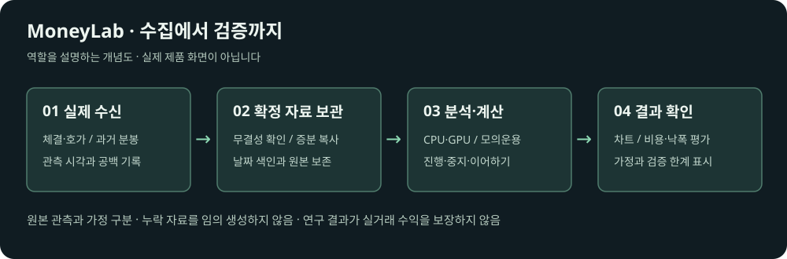

# 구성과 데이터 처리 기준

개념도는 역할 설명용이며 실제 제품 화면이나 운영 상태의 증거가 아닙니다.

| 역할 | 담당 작업 |
|---|---|
| 수집 컴퓨터 | 실제 체결·호가 수신, 과거 분봉 조회, 원본 저장, 관측 메타데이터 기록 |
| 메인 컴퓨터 | 확정 파일 가져오기, 무결성 확인, 날짜 색인, 연구·모의운용, 상태 표시 |
| GPU | 병렬 처리에 적합한 다수 전략·신호 계산 |
| CPU | 통신·파일 관리, 순차 상태 계산, 결과 저장 및 화면 제공 |

## 데이터 구분

- **체결·호가 원본:** 실제로 수신한 사건과 수신 시각을 보존합니다. 시장 전체의 완전한 기록은 아닙니다.
- **1초봉:** 수신한 체결을 초별로 요약한 파생 자료입니다. 과거 초봉 조회나 빈 시간 보간 결과가 아닙니다.
- **분봉:** 공급자가 제공한 과거 분봉 자료입니다. 공급 범위와 관측 범위를 구분합니다.
- **검사 입력:** 코드 검증만을 위한 인공 입력입니다. 시장 관측 자료와 전략 학습에 섞지 않습니다.

## 재사용·검증

입력 해시, 설정, 계산 코드 버전이 일치하는 완료 결과를 재사용합니다. 조건이 바뀌면 해당 범위를 다시 계산합니다. 중단·오류 결과를 완료 결과로 재사용하지 않습니다.

탐색에 사용한 날짜는 이후 독립 검증 자료라고 부르지 않습니다. 비용과 지연 가정을 바꾸어 민감도를 확인하고, 거래가 없거나 미청산 포지션이 남은 결과를 수익성 증거로 과장하지 않습니다.

실계좌·실주문 연결 및 거래 전략 구현은 이 공개 저장소의 범위에 포함되지 않습니다.
